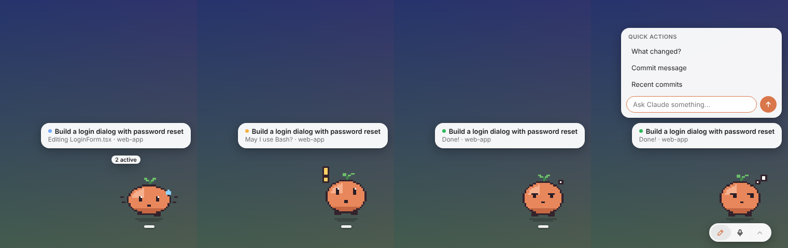

<p align="center"></p>

<h1 align="center">Pixie</h1>

<p align="center">Ein kleines Desktop-Pet, das zeigt, was <b>Claude Code</b> gerade macht – und mit dem du Claude etwas fragen kannst, ohne das Fenster zu wechseln.<br>
Kompatibel mit <b>Codex-Pets</b>, du kannst also deine eigenen mitbringen.</p>

<p align="center"><a href="README.md">English</a></p>



## Was Pixie macht

Pixie schwebt in einer Bildschirmecke über deinen Fenstern. Eine Karte über dem Pet zeigt die Aufgabe, die du Claude gegeben hast (deinen Prompt), und den aktuellen Schritt, z. B. *„Bearbeite LoginForm.tsx · web-app“*. Der Punkt zeigt den Zustand:

| Punkt | Zustand | Animation |
|---|---|---|
| 🔵 | **Arbeitet** – denkt nach oder benutzt ein Tool | Arbeiten |
| 🟡 | **Wartet auf dich** – Rechte-Abfrage oder Rückfrage (+ Systembenachrichtigung) | einmal Winken, dann Warten |
| 🟢 | **Fertig** – bleibt stehen, bis du es gesehen hast (Klick auf Karte oder Pet) | Prüfen |
| 🔴 | **Blockiert** – etwas ist fehlgeschlagen | Fehlerreaktion |

Fährst du mit der Maus aufs Pet, erscheinen darunter drei Knöpfe:

- ✎ **Claude fragen** – Frage eintippen oder Schnellaktion wählen; läuft über `claude -p`, die Antwort erscheint im Panel
- 🎙 **Spracheingabe** – sprechen statt tippen. Wird **lokal** mit Whisper umgewandelt: kein Konto, kein API-Schlüssel, die Aufnahme verlässt den Rechner nicht
- ⌃ **Letzte Antwort**

Rechtsklick → **Pet anpassen…** ändert die Größe (live, wird gespeichert). Karte und Knöpfe folgen dem hellen bzw. dunklen Modus des Systems.

Außerdem: Klick aufs Pet lässt es hüpfen, du kannst es überallhin ziehen (es läuft mit), es schaut zur Maus, schläft irgendwann ein, und mehrere Claude-Code-Sitzungen zeigt es als „2 aktiv“ – wer auf dich wartet, hat Vorrang.

## Installation

1. Installer für dein System unter [**Releases**](../../releases) herunterladen (macOS `.dmg`, Windows `.exe`, Linux `.AppImage`).
2. Pixie starten und auf der Karte **„Mit Claude Code verbinden“** klicken. Das trägt ein paar Hooks in `~/.claude/settings.json` ein (vorher wird ein Backup angelegt, deine eigenen Hooks bleiben unangetastet).
3. Laufende Claude-Code-Sitzungen neu starten. Fertig. Rechtsklick → **Verbindung prüfen** zeigt, ob Pixie schon etwas von Claude Code gehört hat.

> Pixie verfolgt **Claude Code auf deinem Rechner** – im Terminal oder im Bereich *Code* der Claude-Desktop-App. Chats und Cloud-Sitzungen laufen auf Anthropics Servern, ihre Hooks erreichen deinen Rechner also nie.

> **Windows:** Pixie kommt auch in den [Microsoft Store](https://apps.microsoft.com/detail/9MXX7C3SVWDG) – von dort installiert ist es von Microsoft signiert, ohne Warnungen und aktualisiert sich selbst.

> **macOS:** Die App ist noch nicht von Apple notarisiert, deshalb meldet macOS beim ersten Start einen *nicht verifizierten Entwickler*. Pixie einmal öffnen, dann unter **Systemeinstellungen → Datenschutz & Sicherheit** auf **Dennoch öffnen** klicken (bis macOS 14: Rechtsklick auf Pixie → **Öffnen**). Nur beim ersten Mal nötig.
> **Windows:** SmartScreen warnt eventuell vor einem unbekannten Herausgeber → **Weitere Informationen → Trotzdem ausführen**.

Die Hooks rufen `curl` direkt auf (ohne Shell, funktioniert also mit Bash, Git Bash und PowerShell; curl ist bei macOS, Linux und Windows 10+ dabei) und laufen im Hintergrund (`async`): Claude Code wartet nie auf Pixie und wird nie von ihm blockiert, egal ob Pixie läuft oder nicht. Hooks älterer Pixie-Versionen werden beim Start automatisch aktualisiert.

## Pets – kompatibel mit Codex

Pixie spielt Spritesheets im **Codex-Pet-Format** ab. Pets für ChatGPT/Codex funktionieren also unverändert:

- Pets in `~/.codex/pets/` werden automatisch gefunden (z. B. installiert mit `npx codex-pets add <id>`).
- Eigene Pets kommen nach `~/.pixie/pets/<name>/` (Menü → Pet → *Ordner für eigene Pets öffnen*).
- Wechseln über **Rechtsklick → Pet**. *Pets neu einlesen* zeigt, wie viele gefunden wurden und warum ein Ordner übersprungen wurde.
- Die eingebauten Codex-Pets stecken in der Codex-App selbst, nicht in `~/.codex/pets` – angezeigt werden also nur eigene bzw. installierte Codex-Pets.

Ein Pet ist ein Ordner mit `pet.json` und `spritesheet.webp` (oder `.png`): 8 Spalten, Zellen à 192 × 208 px, transparenter Hintergrund.

| Zeile | Animation | Bilder | Pixie nutzt sie, wenn … |
|---|---|---|---|
| 1 | Ruhen (Atmen, Blinzeln) | 6 | nichts los ist |
| 2 / 3 | Nach rechts / links laufen | 8 | du das Pet ziehst |
| 4 | Winken | 4 | zur Begrüßung oder wenn Claude dich braucht |
| 5 | Hüpfen | 5 | du aufs Pet klickst |
| 6 | Fehlerreaktion | 8 | eine Aufgabe blockiert ist |
| 7 | Warten | 6 | Claude auf deine Eingabe wartet |
| 8 | Arbeiten | 6 | Claude nachdenkt oder Tools benutzt |
| 9 | Prüfen | 6 | ein Ergebnis zum Ansehen bereitliegt |
| 10 / 11 | Blickrichtungen | 8 + 8 | die Maus in der Nähe ist (ein Einzelbild aus 16 Richtungen) |

Ältere Sheets mit 9 Zeilen (1536 × 1872) gehen auch – das Pet folgt dann nur nicht der Maus. Die Bildanzahl pro Zeile wird anhand der transparenten Felder erkannt. Optional in `pet.json`: `"pixelated": true` hält Pixel-Art beim Skalieren scharf.

**Pixelchen**, das Standard-Pet, wird per Code gezeichnet (`tools/pixelchen.js`, mit denselben Werkzeugen wie der Skill) und ist selbst ein normales Codex-Pet: `pets/pixelchen/` nach `~/.codex/pets/` kopieren, dann gibt es Pixelchen auch in Codex. Nach Änderungen erzeugt `npm run build-pets` Sheet und App-Icon neu.

### Eigene Pets bauen – oder von Claude bauen lassen

Im Repo liegt ein **Claude-Skill** ([`skills/pixie-pet`](skills/pixie-pet/SKILL.md)), mit dem Claude dir ein komplettes Pet gestaltet: Es zeichnet die Pixel-Art in Code, prüft das Format, schaut sich eine Vorschau aller Bilder an und bessert nach. Skill installieren, dann einfach fragen:

> Nutze den Skill pixie-pet und mach mir ein Pet: einen verschlafenen kleinen Kaktus im Tontopf, der mit einem Arm winkt und den Kopf hängen lässt, wenn etwas schiefgeht.

→ [Anleitung: Eigene Pets bauen](docs/making-pets.de.md) (mit Claude, von Hand oder im Zeichenprogramm)

## Einstellungen

Rechtsklick → *Einstellungen öffnen* öffnet `~/.pixie/config.json`:

| Schlüssel | Bedeutung |
|---|---|
| `language` | `"auto"` (System), `"de"` oder `"en"` |
| `petScale` | Größe; 0.65 ≈ 125 × 135 px, 1 = Originalgröße |
| `prompts` | Schnellaktionen: `[{ "label": "…", "prompt": "…" }]` (`null` = mitgelieferte Beispiele) |
| `promptCwd` | Ordner, in dem Schnellfragen laufen (z. B. dein aktuelles Projekt) |
| `claudeCommand`, `claudeArgs` | wie `claude -p` aufgerufen wird. Pixie findet Claude Code selbst (PATH, übliche Installationsorte, laufende Sitzung, Claude-Desktop-App); einen vollen Pfad nur eintragen, wenn das nicht klappt. Standardmäßig nur lesende Tools und Git-Lesebefehle |
| `voice.enabled`, `voice.language` | Spracheingabe an/aus; `"auto"` oder z. B. `"de"` |
| `voice.model` | `onnx-community/whisper-base` (≈ 85 MB, Standard), `…/whisper-small` (≈ 250 MB, genauer – lohnt sich für Deutsch) |
| `voice.autoSend` | direkt nach dem Umwandeln senden, statt den Text erst zu zeigen |
| `readyTimeoutSeconds` | `0` = „Fertig“ bleibt bis zum Ansehen; sonst nach n Sekunden ausblenden |
| `notifyOnInput` | Systembenachrichtigung, wenn Claude dich braucht |
| `port`, `shortcut` | lokaler Port (47821) und Tastenkürzel zum Ein-/Ausblenden (Strg/⌘+Alt+P) |

Das Sprachmodell wird beim ersten Benutzen einmalig nach `~/.pixie/models` geladen.

**Schnellfragen und Anmeldung:** Wer Claude Code nur über die Desktop-App nutzt, dessen Claude Code wird von der App angemeldet, nicht eigenständig. Bei der ersten Schnellfrage bittet Pixie dann einmal um Anmeldung: auf **Anmelden** klicken, im geöffneten Terminal `/login` eingeben, fertig.

## Andere Agenten anbinden

Jedes Programm auf deinem Rechner kann das Pet steuern:

```bash
curl -X POST http://127.0.0.1:47821/state \
  -H 'Content-Type: application/json' -H 'X-Pixie: 1' \
  -d '{"state":"working","task":"Intro rendern","message":"Kodiere Video","project":"mein-agent"}'
```

Zustände: `idle`, `thinking`, `working`, `needsInput`, `done`, `error`. Der Header `X-Pixie` ist Pflicht – so können Webseiten im Browser nicht mit dem Pet sprechen.

## Entwicklung

```bash
npm install
npm start                # aus dem Quellcode starten
npm test                 # Tests
npm run dist             # Installer lokal nach dist/ bauen
```

Release: `version` in `package.json` erhöhen und auf `main` pushen (oder einen Tag wie `v0.5.0` pushen). GitHub Actions baut die Installer für macOS, Windows und Linux und hängt sie an einen Release-Entwurf – prüfen und auf *Publish* klicken.

## Datenschutz

Alles bleibt auf deinem Rechner. Die Hooks sprechen nur mit `127.0.0.1`, die Spracheingabe läuft lokal. Netzwerkzugriff gibt es nur für den einmaligen Download des Sprachmodells von Hugging Face – und natürlich durch Claude Code selbst. Details: [Datenschutzerklärung](docs/privacy.md#deutsch).

## Hinweis

Pixie ist ein unabhängiges Community-Projekt und steht in keiner Verbindung zu Anthropic oder OpenAI. „Claude“ und „Claude Code“ sind Marken von Anthropic, „Codex“ und „ChatGPT“ Marken von OpenAI. Pets aus anderen Quellen gehören ihren Urheber:innen.

## Lizenz

[MIT](LICENSE)
