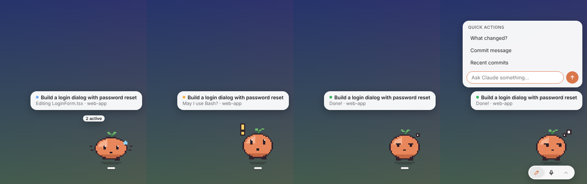

<p align="center"></p>

<h1 align="center">Pixie</h1>

<p align="center">A tiny desktop pet that shows what <b>Claude Code</b> is doing – and lets you ask Claude something without switching windows.<br>
Works with <b>Codex pets</b>, so you can bring your own.</p>

<p align="center"><a href="README.de.md">Deutsch</a></p>



## What it does

Pixie floats above your windows in a corner of the screen. A card above it shows the task you gave Claude (your prompt) and the step it's on right now, e.g. *"Editing LoginForm.tsx · web-app"*. The dot tells you the state at a glance:

| Dot | State | Pet animation |
|---|---|---|
| 🔵 | **Working** – thinking or using a tool | Work |
| 🟡 | **Needs input** – permission prompt or a question for you (+ system notification) | Wave once, then Wait |
| 🟢 | **Done** – stays until you've seen it (click the card or the pet) | Review |
| 🔴 | **Blocked** – something failed | Failed |

Hover over the pet and three buttons appear below it:

- ✎ **Ask Claude** – type a question or pick a quick action; runs `claude -p` and shows the answer
- 🎙 **Voice input** – speak instead of typing. Transcribed **locally** with Whisper: no account, no API key, audio never leaves your computer
- ⌃ **Last answer**

Right-click → **Customize pet…** changes its size (live, remembered). The card and buttons follow your system's light/dark mode.

More: click the pet to make it hop, drag it anywhere (it runs along), it looks towards your mouse, falls asleep after a while, and several Claude Code sessions at once are shown as "2 active" – whoever needs you wins.

## Install

1. Download the installer for your system from [**Releases**](../../releases) (macOS `.dmg`, Windows `.exe`, Linux `.AppImage`).
2. Start Pixie and click **"Connect to Claude Code"** on the card. This adds a few hooks to `~/.claude/settings.json` (a backup is made first; your existing hooks stay untouched).
3. Restart running Claude Code sessions. Done. Right-click → **Check connection** shows whether Pixie has heard from Claude Code.

> Pixie follows **Claude Code running on your computer** – in a terminal or in the *Code* section of the Claude desktop app. Chats and cloud sessions run on Anthropic's servers, so their hooks never reach your machine.

> **macOS:** the app isn't signed with an Apple developer certificate yet. On first launch, right-click Pixie → **Open**. If macOS says the app is "damaged", run `xattr -cr /Applications/Pixie.app` once.
> **Windows:** SmartScreen may warn about an unknown publisher → **More info → Run anyway**.

The hooks run `curl` directly (no shell, so Bash, Git Bash and PowerShell all work; curl ships with macOS, Linux and Windows 10+) and in the background (`async`): Claude Code never waits for Pixie and is never blocked by it, whether Pixie is running or not. Hooks from older Pixie versions are updated automatically on start.

## Pets – compatible with Codex

Pixie plays spritesheets in the **Codex pet format**, so pets made for ChatGPT/Codex work unchanged:

- Pets in `~/.codex/pets/` are found automatically (e.g. installed with `npx codex-pets add <id>`).
- Put your own pets in `~/.pixie/pets/<name>/` (menu → Pet → *Open folder for your pets*).
- Switch pets via **right-click → Pet**. *Rescan pets* tells you how many it found and why a folder was skipped.
- Codex's built-in pets live inside the Codex app, not in `~/.codex/pets`, so only your own/installed Codex pets show up.

A pet is a folder with `pet.json` and `spritesheet.webp` (or `.png`): 8 columns, cells of 192 × 208 px, transparent background.

| Row | Animation | Frames | Pixie uses it when … |
|---|---|---|---|
| 1 | Idle (breathe, blink) | 6 | nothing's going on |
| 2 / 3 | Run right / left | 8 | you drag the pet |
| 4 | Wave | 4 | greeting, or Claude needs you |
| 5 | Jump | 5 | you click the pet |
| 6 | Failed | 8 | a task is blocked |
| 7 | Waiting | 6 | Claude waits for your input |
| 8 | Working | 6 | Claude is thinking or using tools |
| 9 | Review | 6 | a result is ready to look at |
| 10 / 11 | Look directions | 8 + 8 | your mouse is nearby (one frame from 16 directions) |

Older 9-row sheets (1536 × 1872) work too – the pet just won't follow your mouse. Frames per row are detected from the transparent cells. Optional extra in `pet.json`: `"pixelated": true` keeps pixel art crisp when scaled.

**Pixelchen**, the default pet, is drawn in code (`tools/pixelchen.js`, built with the same tools as the skill) and is a regular Codex pet as well: copy `pets/pixelchen/` to `~/.codex/pets/` to use it in Codex. After changing the drawing, `npm run build-pets` rebuilds the sheet and the app icon.

### Make your own pet – or let Claude make one

This repo includes a **Claude skill** ([`skills/pixie-pet`](skills/pixie-pet/SKILL.md)) that lets Claude design a complete pet for you: it draws the pixel art in code, checks the format, looks at a preview of every frame and fixes what's off. Install the skill, then just ask:

> Use the pixie-pet skill to make me a pet: a sleepy little cactus in a clay pot that waves with one arm and wilts when something fails.

→ [How to make pets](docs/making-pets.md) (with Claude, by hand, or from an art program)

## Settings

Right-click → *Open settings* opens `~/.pixie/config.json`:

| Key | Meaning |
|---|---|
| `language` | `"auto"` (system), `"de"` or `"en"` |
| `petScale` | size; 0.65 ≈ 125 × 135 px, 1 = full size |
| `prompts` | quick actions: `[{ "label": "…", "prompt": "…" }]` (`null` = built-in examples) |
| `promptCwd` | folder quick actions run in (e.g. your current project) |
| `claudeCommand`, `claudeArgs` | how `claude -p` is called. Pixie finds Claude Code on its own (PATH, usual install folders, a running session, the Claude desktop app); set a full path here only if that fails. By default only read-only tools and git read commands are allowed |
| `voice.enabled`, `voice.language` | voice input on/off; `"auto"` or e.g. `"de"` / `"en"` |
| `voice.model` | `onnx-community/whisper-base` (≈ 85 MB, default), `…/whisper-small` (≈ 250 MB, more accurate) |
| `voice.autoSend` | send right after transcribing instead of letting you check the text |
| `readyTimeoutSeconds` | `0` = "Done" stays until seen; otherwise fade after n seconds |
| `notifyOnInput` | system notification when Claude needs you |
| `port`, `shortcut` | local port (47821) and show/hide shortcut (Ctrl/⌘+Alt+P) |

The speech model is downloaded once on first use into `~/.pixie/models`.

## Use it with other agents

Anything on your machine can drive the pet:

```bash
curl -X POST http://127.0.0.1:47821/state \
  -H 'Content-Type: application/json' -H 'X-Pixie: 1' \
  -d '{"state":"working","task":"Render the intro","message":"Encoding video","project":"my-agent"}'
```

States: `idle`, `thinking`, `working`, `needsInput`, `done`, `error`. The `X-Pixie` header is required – it keeps websites in your browser from talking to the pet.

## Development

```bash
npm install
npm start                # run from source
npm test                 # unit + integration tests
npm run dist             # build installers locally into dist/
```

Releases: bump `version` in `package.json` and push to `main` (or push a tag like `v0.5.0`). GitHub Actions builds macOS, Windows and Linux installers and attaches them to a draft release – review it and click *Publish*.

```
main.js            Electron main process: window, tray, menu, IPC
src/state.js       hook events → one pet state (pure, tested)
src/server.js      local HTTP endpoint for hooks and other agents
src/hooks.js       adds/removes the hooks in Claude Code's settings
src/pets.js        finds pets (built-in, ~/.pixie/pets, ~/.codex/pets)
src/voice*.js      Whisper via Transformers.js in a worker thread
renderer/          the overlay: sheet player, card, dock, voice recording
skills/pixie-pet/  Claude skill + tools to build, validate and preview pets
tools/             Pixelchen (a pet module) and the app icon builder
```

## Privacy

Everything stays on your computer. The hooks only talk to `127.0.0.1`; voice is transcribed locally. The only network access is the one-time speech model download from Hugging Face and, of course, Claude Code itself.

## Disclaimer

Pixie is an independent community project, not affiliated with or endorsed by Anthropic or OpenAI. "Claude" and "Claude Code" are trademarks of Anthropic; "Codex" and "ChatGPT" are trademarks of OpenAI. Pets you install from elsewhere belong to their creators.

## License

[MIT](LICENSE)
