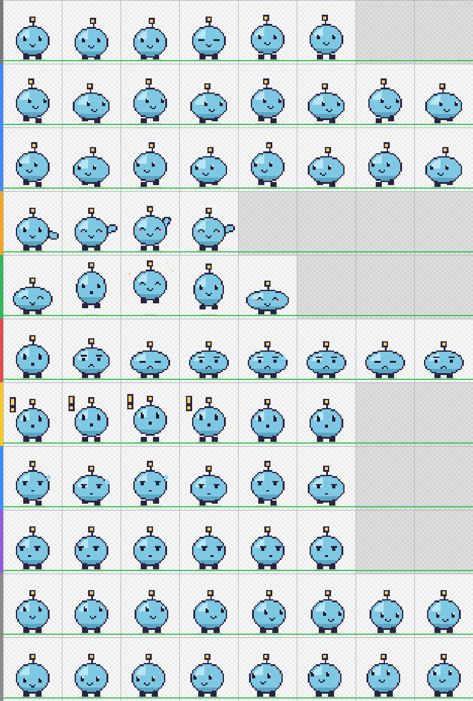

# Eigene Pets bauen

Am einfachsten: **Lass Claude das Pet gestalten.** In diesem Repo liegt ein Claude-Skill, [`skills/pixie-pet`](../skills/pixie-pet/SKILL.md). Er bringt Claude das Pet-Format bei, gibt ihm Zeichenwerkzeuge und lässt es die eigene Arbeit prüfen: Ein Validator meldet Formatfehler, und nach jedem Bauen schaut sich Claude einen Kontaktbogen aller Bilder an. Claude zeichnet das Pet als Pixel-Art in Code. Dadurch bleiben alle Bilder einheitlich, und man braucht keinen Bildgenerator.



## 1. Claude den Skill geben

**Claude Code** – den Skill-Ordner zu deinen Skills kopieren:

```bash
# im geklonten Repo
mkdir -p ~/.claude/skills && cp -r skills/pixie-pet ~/.claude/skills/
```

**Claude-App (claude.ai / Desktop)** – `pixie-pet-skill.zip` aus dem [neuesten Release](../../../releases/latest) herunterladen und in den Einstellungen von Claude als Skill hinzufügen (Skills). Dafür muss die Code-Ausführung eingeschaltet sein.

## 2. Ein Pet bestellen

Beschreib die Figur und, wenn du magst, wie sie sich in den Zuständen verhält. Zum Beispiel:

> Nutze den Skill pixie-pet und mach mir ein Pet: einen verschlafenen kleinen Kaktus im Tontopf. Er winkt mit einem Arm, schwitzt beim Arbeiten, hält beim Prüfen eine winzige Lupe und lässt den Kopf hängen, wenn etwas schiefgeht. Installier es in Pixie.

> Mach ein Pixie-Pet: einen Papierflieger mit Gesicht, blau-weiß. Wenn er auf mich wartet, schwebt er auf und ab, wenn er fertig ist, fliegt er einen Looping.

> Mach mir ein Pet nach meiner Katze Mochi: grau, weiße Brust, grüne Augen, etwas pummelig. Schlicht und süß.

(Genau so ist **Pricklet** entstanden, der Kaktus, der bei Pixie mitgeliefert wird: ein Prompt, vier Runden, nichts von Hand gezeichnet. Der Code liegt in [`skills/pixie-pet/examples/pricklet.js`](../skills/pixie-pet/examples/pricklet.js).)

Claude schlägt die Idee vor oder bestätigt sie, baut das Spritesheet, prüft es, schaut sich die Vorschau an und bessert nach (meist 2–4 Runden). Dann zeigt es dir das Ergebnis. In Claude Code installiert es das Pet direkt nach `~/.pixie/pets/`, in der Claude-App bekommst du eine ZIP-Datei zum Entpacken dorthin.

Danach in Pixie: **Rechtsklick → Pet → Pets neu einlesen** und das Pet auswählen. Derselbe Ordner funktioniert auch in Codex (`~/.codex/pets/`).

Änderungswünsche einfach sagen: *„größere Augen“*, *„die Arbeiten-Animation hektischer“*, *„orange statt grün“*.

**Bitte nur eigene Figuren.** Claude baut keine Figuren, Maskottchen oder Logos nach, die anderen gehören. Pets, die du öffentlich teilst, sollten das auch nicht tun.

## Selbst machen

Alles, was Claude benutzt, funktioniert auch für dich (Node.js 18+, sonst nichts):

```bash
cd skills/pixie-pet
cp templates/pet-template.js mein-pet.js            # vollständiges Beispiel-Pet als Start
node scripts/build-pet.js mein-pet.js out/mein-pet # → spritesheet.png + pet.json
node scripts/validate-pet.js out/mein-pet          # Format- und Qualitätsprüfung
node scripts/preview-pet.js out/mein-pet           # → out/mein-pet/preview.png
```

### Im Zeichenprogramm (Aseprite, Photoshop, Krita …)

- Leeres Hilfsraster: `node scripts/assemble-pet.js --template raster.png` (Zellen, Fußlinie, Mittellinie, Felder, die leer bleiben).
- Entweder das ganze Sheet mit 1536 × 2288 Pixeln zeichnen oder Einzelbilder als `idle-1.png … look-16.png` exportieren und dann
  `node scripts/assemble-pet.js frames/ out/mein-pet --id mein-pet --name "Mein Pet"` ausführen.

### Mit einem Bildgenerator

Das geht, ist aber mühsamer: Generatoren verändern die Figur gern von Bild zu Bild und liefern selten saubere Transparenz. Am besten erst ein Referenzbild erzeugen, dann die Bilder Zeile für Zeile, Hintergründe entfernen, zusammensetzen und prüfen. Die Vorschau genau ansehen.

## Das Format in Kürze

8 Spalten × 11 Zeilen, Zellen à 192 × 208 px, transparentes PNG oder WebP, dazu eine `pet.json`:

```json
{ "id": "mein-pet", "displayName": "Mein Pet", "description": "…", "spritesheetPath": "spritesheet.png" }
```

| Zeile | Animation | Bilder |
|---|---|---|
| 1 | Ruhen (Atmen, Blinzeln) | 6 |
| 2 / 3 | Nach rechts / links laufen | 8 |
| 4 | Winken | 4 |
| 5 | Hüpfen: Start, Aufstieg, Höhepunkt, Abstieg, Landung | 5 |
| 6 | Fehlerreaktion | 8 |
| 7 | Auf Eingabe warten | 6 |
| 8 | Arbeiten / Nachdenken | 6 |
| 9 | Prüfen | 6 |
| 10 / 11 | Blickrichtungen, im Uhrzeigersinn ab oben | 8 + 8 |

Die vollständige Anleitung mit Gestaltungsregeln steht in [`SKILL.md`](../skills/pixie-pet/SKILL.md). Sie ist für Claude geschrieben, aber für Menschen genauso brauchbar.
