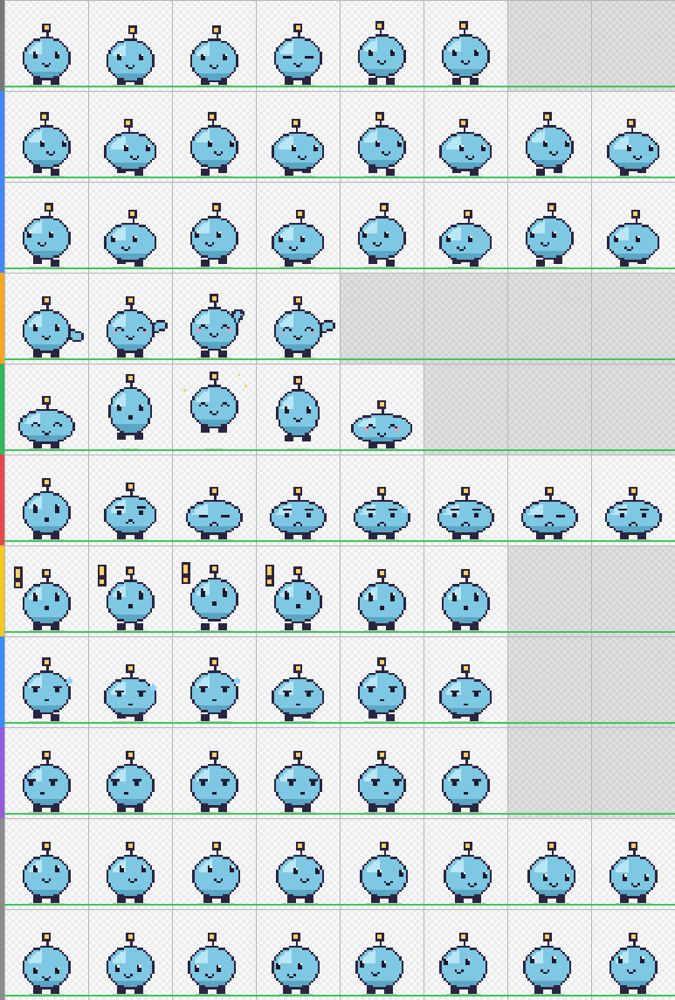

# Make your own pet

The easiest way: **let Claude design it.** This repo contains a Claude skill, [`skills/pixie-pet`](../skills/pixie-pet/SKILL.md), that teaches Claude the pet format, gives it drawing helpers, and lets it check its own work (a validator and a contact-sheet preview it looks at after every build). Claude draws the pet as pixel art in code, so all frames stay consistent and no image generator is needed.



## 1. Give Claude the skill

**Claude Code** – copy the skill folder into your skills:

```bash
# from a clone of this repo
mkdir -p ~/.claude/skills && cp -r skills/pixie-pet ~/.claude/skills/
```

**Claude app (claude.ai / desktop)** – download `pixie-pet-skill.zip` from the [latest release](../../../releases/latest) and add it as a skill in Claude's settings (Skills). Claude needs code execution enabled for this.

## 2. Ask for a pet

Describe the character and, if you like, how it behaves in the different states. Some examples:

> Use the pixie-pet skill to make me a pet: a sleepy little cactus in a clay pot. It waves with one arm, sweats while working, holds a tiny magnifier when reviewing, and wilts when something fails. Install it in Pixie.

> Make a Pixie pet that's a paper airplane with a face. Blue and white. When it waits for me it hovers up and down, when it's done it does a loop.

> Make me a pet based on my cat Mochi: grey, white chest, green eyes, chubby. Keep it cute and simple.

(The first example is exactly how **Pricklet**, the cactus that ships with Pixie, was made: one prompt, four build rounds, no manual drawing. Its source is in [`skills/pixie-pet/examples/pricklet.js`](../skills/pixie-pet/examples/pricklet.js).)

Claude will propose or confirm the idea, build the spritesheet, validate it, look at the preview, fix what's off (usually 2–4 rounds) and show you the result. In Claude Code it installs the pet into `~/.pixie/pets/` directly; in the Claude app you get a zip to unpack there.

Then in Pixie: **right-click → Pet → Rescan pets** and pick it. The same folder works in Codex (`~/.codex/pets/`).

Want changes? Just say so: *"bigger eyes"*, *"make the working animation more frantic"*, *"orange instead of green"*.

**Please keep pets original.** Claude won't recreate characters, mascots or logos owned by others – and pets you share publicly shouldn't either.

## Doing it yourself

Everything Claude uses works for you too (Node.js 18+, no other dependencies):

```bash
cd skills/pixie-pet
cp templates/pet-template.js my-pet.js           # a complete example pet to start from
node scripts/build-pet.js my-pet.js out/my-pet  # → spritesheet.png + pet.json
node scripts/validate-pet.js out/my-pet         # format and quality checks
node scripts/preview-pet.js out/my-pet          # → out/my-pet/preview.png
```

### Drawing in an art program (Aseprite, Photoshop, Krita…)

- Empty guide grid: `node scripts/assemble-pet.js --template grid.png` (cells, feet line, centre line, cells that stay empty).
- Either draw the whole 1536 × 2288 sheet, or export single frames named `idle-1.png … look-16.png` and run
  `node scripts/assemble-pet.js frames/ out/my-pet --id my-pet --name "My Pet"`.

### With an image generator

Possible, but harder: generators tend to change the character between frames and rarely produce clean transparency. Generate a reference image first, then the frames row by row, remove backgrounds, assemble and validate. Check the preview carefully.

## The format in short

8 columns × 11 rows, 192 × 208 px per cell, transparent PNG or WebP, plus a `pet.json`:

```json
{ "id": "my-pet", "displayName": "My Pet", "description": "…", "spritesheetPath": "spritesheet.png" }
```

| Row | Animation | Frames |
|---|---|---|
| 1 | Idle (breathe, blink) | 6 |
| 2 / 3 | Run right / left | 8 |
| 4 | Wave | 4 |
| 5 | Jump: start, rise, peak, fall, land | 5 |
| 6 | Failed | 8 |
| 7 | Waiting for input | 6 |
| 8 | Working / thinking | 6 |
| 9 | Review | 6 |
| 10 / 11 | Look directions, clockwise from up | 8 + 8 |

The full guide with design rules is in [`SKILL.md`](../skills/pixie-pet/SKILL.md) – it's written for Claude, but it's just as useful for people.
